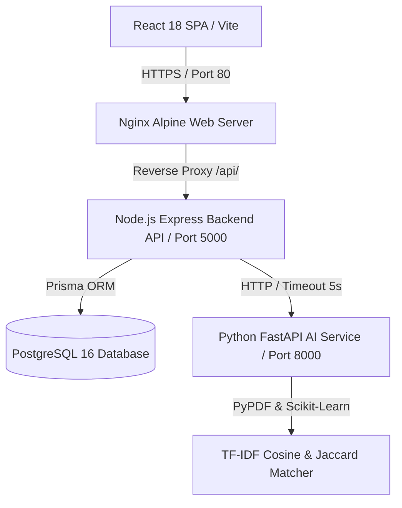

# PlaceMux — AI-Powered Campus Placement & Recruitment Platform

[](https://www.typescriptlang.org/)
[](https://nodejs.org/)
[](https://react.dev/)
[](https://fastapi.tiangolo.com/)
[](https://www.postgresql.org/)
[](https://www.prisma.io/)
[](https://www.docker.com/)

PlaceMux is a production-grade, secure, multi-tenant campus placement and recruitment platform. It connects **Students**, **Recruiting Companies**, **College Placement Cells**, and **Platform Administrators** in a unified ecosystem powered by an explainable Python AI Microservice for resume parsing and candidate-to-job match recommendations.

---

## 1. Project Overview
PlaceMux modernizes higher education campus placements by replacing manual resume screening and fragmented communication with an automated, data-driven platform. It combines real-time PostgreSQL analytics, dual-token JWT security, anti-cheat timed online assessments, multi-tenant college data boundaries, and explainable AI candidate matching.

---

## 2. Problem Statement
Traditional university recruitment workflows suffer from:
- **Manual Resume Screening**: Placement teams manually audit thousands of student resumes against company criteria.
- **Opacity in Candidate Evaluation**: Students lack feedback on why they were rejected or what skills they should acquire for target roles.
- **Data Boundary Gaps**: University placement cells lack isolated tenant boundaries to manage only their enrolled students.
- **Recruiter Overhead**: Fragmented tools for managing applications, scheduling interviews, issuing offers, and conducting timed technical tests.

---

## 3. Key Features
- **Explainable AI Matching**: 55% Jaccard Skill Overlap + 30% TF-IDF Cosine Text Similarity + 15% Academic Eligibility score calculation.
- **Microservices Resiliency**: Decoupled Python FastAPI AI Engine with graceful rule-based fallback handling in Node.js if the AI service is offline.
- **10-Stage Application Pipeline**: Status progression tracking (`APPLIED` $\rightarrow$ `SHORTLISTED` $\rightarrow$ `ASSESSMENT` $\rightarrow$ `ASSESSMENT_PASSED` $\rightarrow$ `INTERVIEW` $\rightarrow$ `SELECTED` $\rightarrow$ `OFFERED` $\rightarrow$ `ACCEPTED`, plus `REJECTED`, `WITHDRAWN`) with audit history.
- **Anti-Cheat Online Assessment Engine**: Timed sessions for 6 question types (`MCQ`, `MULTI_SELECT`, `APTITUDE`, `TECHNICAL`, `SQL`, `CODING`) with `correctAnswer` masking in student payloads.
- **Multi-Tenant College Scoping**: Strict `collegeId` scoping allowing colleges to manage and verify their own student rosters.

---

## 4. User Roles & Access Control
- 🎓 **STUDENT**: Profile management, skills matrix, project portfolio, resume upload, AI analyzer, job discovery, application tracking, assessment runner, interview & offer responses.
- 🏢 **COMPANY**: Recruiter profile, hiring drive manager, assessment test builder, application reviewer, interview scheduler, offer letter generator.
- 🏛 **COLLEGE**: Campus dashboard analytics, college-scoped student roster management, student verification toggle, drive-specific eligible list generator.
- 🛡 **ADMIN**: Platform-wide PostgreSQL analytics dashboard (9 KPI metrics), user governance (`ACTIVE`/`SUSPENDED`), recruiter verification approval, job drive moderation, system audit log trail.

---

## 5. System Architecture



---

## 6. Technology Stack

| Domain | Technologies Used |
| :--- | :--- |
| **Frontend Web App** | React 18, Vite 5, TypeScript 5.6, Tailwind CSS 3, Lucide Icons, Axios, React Router v6 |
| **Backend API** | Node.js 20, Express 4, TypeScript 5.6, Prisma ORM 5.20, Zod, JWT, BcryptJS, Helmet, Rate-Limit |
| **AI Microservice** | Python 3.11, FastAPI 0.110, Uvicorn, Scikit-learn, NumPy, PyPDF 6.19, Pytest, HTTPX |
| **Database** | PostgreSQL 16 (JSONB support, cascade constraints, indexed foreign keys) |
| **DevOps & Containerization** | Docker, Docker Compose, Nginx Alpine, Multi-stage builds, Healthchecks |

---

## 7. Database Architecture (25 Prisma Entities)

1. `User` (Authentication credentials, role, status)
2. `RefreshToken` (HTTP refresh token rotation)
3. `Student` (Academic profile, CGPA, branch, verification, placement status)
4. `Company` (Recruiter details, verification status)
5. `College` (Institution details, code, accreditation)
6. `Education` (Degrees, institutions, field of study)
7. `Skill` (Master skill taxonomy)
8. `StudentSkill` (Student skill associations)
9. `Project` (Technical projects, repos, live demos)
10. `Certification` (Professional certs & credentials)
11. `Resume` (File URLs, text extractions, AI scores)
12. `Job` (Hiring drives, eligibility thresholds)
13. `JobSkill` (Required drive skills)
14. `Application` (Candidate application submissions)
15. `ApplicationStatusHistory` (Audit trail of application transitions)
16. `Assessment` (Online tests & passing criteria)
17. `Question` (MCQ, Coding, SQL, Aptitude questions)
18. `AssessmentQuestion` (Test question ordering)
19. `AssessmentSession` (Timed student exam sessions)
20. `Response` (Submitted student answers & points)
21. `Interview` (Scheduled interview sessions)
22. `InterviewFeedback` (Reviewer ratings & recommendations)
23. `Offer` (Formal job offer letters)
24. `Notification` (In-app notification alerts)
25. `AuditLog` (System administrative audit logs)

---

## 8. AI Architecture & Microservice Engine

The AI Engine operates as an independent microservice (`ai-service/`):
- **PyPDF Resume Extractor**: Extracts plain text from candidate PDF uploads.
- **NLP Skill Tagging**: Matches resume text against a canonical technical taxonomy (`SKILL_DISPLAY_MAP`).
- **5-Factor Multi-Dimensional Resume Score (0-100)**: Calculates section completeness, skill density, education depth, experience/projects depth, and quantifiable metrics.
- **TF-IDF & Cosine Similarity Matcher**: Converts candidate text and job description into TF-IDF term-frequency vectors and computes cosine similarity.
- **Ethical AI Shield**: Returns a mandatory disclaimer declaring that match percentages are self-assessment support tools and not automated hiring decisions.

---

## 9. Application Lifecycle & Audit History

```
APPLIED ──► SHORTLISTED ──► ASSESSMENT ──► ASSESSMENT_PASSED ──► INTERVIEW ──► SELECTED ──► OFFERED ──► ACCEPTED
   │                                                                                           │
   └──► REJECTED                                                                                └──► OPTED_OUT
   │
   └──► WITHDRAWN
```
Every status change inserts a immutable audit log row in `application_status_history` capturing `applicationId`, `status`, `changedBy`, `remarks`, and `createdAt`.

---

## 10. API Documentation & OpenAPI Swagger

Interactive Swagger UI documentation is served directly by the Express backend at `/api-docs`.
- **Swagger File**: [`backend/src/docs/swagger.yaml`](file:///c:/Users/jaikrishna/OneDrive/Videos/Desktop/placemux/backend/src/docs/swagger.yaml)
- **Live Endpoint**: `http://localhost:5000/api-docs`

---

## 11. Screenshots & Interface Preview

- **Student Portal**: Modern glassmorphic SaaS dashboard displaying profile completion, resume score, recommended jobs, and active applications.
- **Admin Governance**: 9 real-time KPI metrics cards, date/college/company filters, user status toggles, recruiter verification approvals, and audit logs.
- **Assessment Runner**: Anti-cheat timed assessment interface with live countdown timer and question navigator.

---

## 12. Local Development Setup

### 1. Prerequisites
- Node.js v20.x or higher
- Python 3.11.x or higher
- PostgreSQL 16 server running locally on port 5432

### 2. Backend Setup
```bash
cd backend
npm install
npx prisma generate
npx prisma db push
npm run dev
```

### 3. AI Service Setup
```bash
cd ai-service
pip install -r requirements.txt
uvicorn app.main:app --reload --port 8000
```

### 4. Frontend Setup
```bash
cd frontend
npm install
npm run dev
```

---

## 13. Docker & Container Setup

```bash
# Clone repository
git clone https://github.com/jaikrishna/placemux.git
cd placemux

# Build and spin up all containers
docker-compose up --build -d

# Verify health status
docker-compose ps
```

Services:
- **Web App UI**: `http://localhost`
- **Node.js Backend API**: `http://localhost:5000/api`
- **Swagger Documentation**: `http://localhost:5000/api-docs`
- **AI Microservice API**: `http://localhost:8000/docs`

---

## 14. Testing Guide

### Running Backend Integration Tests (Jest)
```bash
cd backend
npm test
```
*Executes 8 test suites / 49 tests covering Authentication, Student Profile, Jobs & Applications, Online Assessments, Interviews & Offers, College Management, AI Proxy, and Admin Governance.*

### Running AI Service Tests (Pytest)
```bash
cd ai-service
python -m pytest
```
*Executes unit tests covering PyPDF resume parsing, NLP skill extraction, and TF-IDF match calculations.*

---

## 15. Production Deployment Guide

1. **Database Provisioning**: Deploy PostgreSQL 16 instance on AWS RDS / GCP Cloud SQL and set `DATABASE_URL`.
2. **Container Deployment**: Deploy `docker-compose.yml` or Kubernetes manifests to AWS ECS / DigitalOcean / GCP.
3. **SSL/TLS & Domain**: Configure Nginx reverse proxy with Let's Encrypt SSL/TLS certificates.

---

## 16. Future Improvements & Roadmap

1. **S3 Cloud Media Storage**: Integrate AWS S3 / Google Cloud Storage pre-signed URLs for candidate resume PDF uploads.
2. **Real-Time WebSockets**: Add Socket.io for instant interview invite and offer notification alerts.
3. **Video Interview Assessments**: Integrate WebRTC for automated video interview recordings.

---

## 🔑 Demo Credentials

| Role | Email | Password | Access Scope |
| :--- | :--- | :--- | :--- |
| **Admin** | `admin@placemux.com` | `Admin123!` | System Analytics, User Governance, Company Verification, Job Moderation, Audit Logs |
| **College** | `college@university.edu` | `College123!` | Campus Dashboard, Student Directory, Student Verification, Eligible Roster Calculation |
| **Company** | `recruiter@techcorp.com` | `Company123!` | Job Drive Creation, Candidate Review, Assessment Builder, Interview Scheduling, Offers |
| **Student** | `student@university.edu` | `Student123!` | Profile Setup, Resume Analyzer, Job Search, Application Tracker, Assessment Runner |

---

## 📜 License
Distributed under the MIT License. See `LICENSE` for details.
